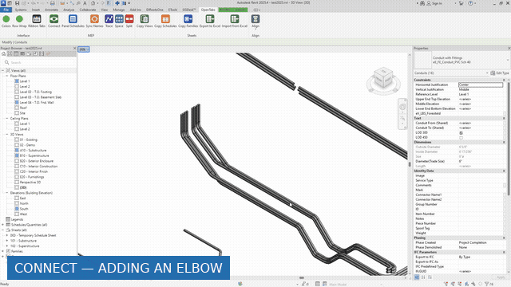
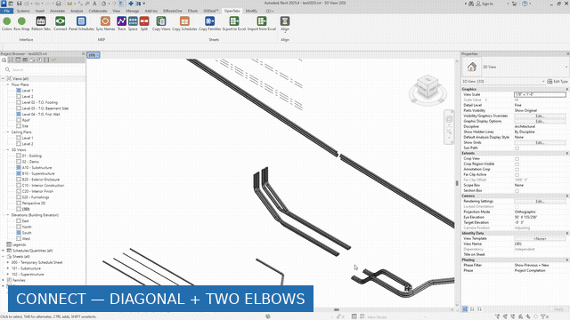
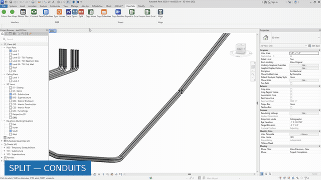
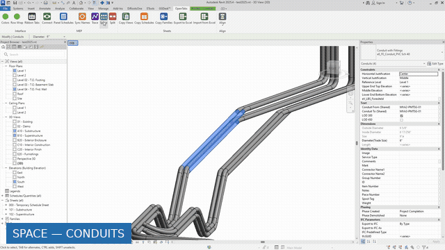
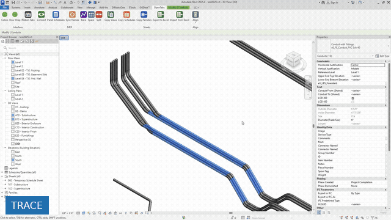
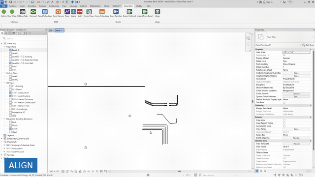
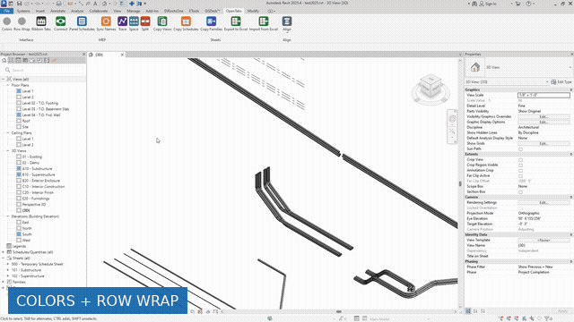

# OpenTabs — public beta

Productivity tools for **Autodesk Revit**: faster MEP modeling, schedule ⇄ Excel round trip, copying content between models, multi-align, and a better view-tab bar.

> **Status: public beta (v0.9.0).** Free to try for **30 days** from the first launch. Please test on a copy of your model and tell us what works and what doesn't — see [Feedback](#feedback).

Works with **Revit 2022, 2023, 2024, 2025 and 2026** (Windows).

---

## What's inside

### Connect
Select a bundle of conduits, cable trays, pipes or ducts and connect their free ends in one click — couplings, elbows, or an **offset: a diagonal with two elbows**. After the connection you can pick another angle (11.25°, 22.5°, 30°, 45°, 60° or a custom value) and apply it again without undoing by hand.

### Split
Cut a whole bundle at once: select the elements, enter the gap (mm or inches), click one point — every selected element is cut across the bundle there. Revit 2024 and newer: split **with a gap**; older versions: plain split with a coupling.

### Space
Equal center-to-center spacing for a bundle of parallel conduits: by a **conduit spacing table** (depends on the sizes of neighbouring conduits), by a **fixed distance**, or **evenly between the two outermost** elements.

### Trace
Select a whole run — conduits, trays, pipes, ducts and their fittings — or the whole electrical circuit of the selected devices and panels.

### Align
Multi-align for **any** elements in the current view: left, right, top, bottom, centers, and distribute evenly.

### Colors + Row Wrap
Color-coded view tabs (one color per open model) and tabs wrapped into several rows, with close buttons.

### More tools
- **Export to Excel / Import from Excel** — export a schedule to `.xlsx` (one row per element, in the schedule's own sort order), edit the values in Excel, import them back. Excel does not have to be installed for the plugin itself.
- **Copy Views / Copy Schedules / Copy Families** — copy sheets, views, schedules and loadable families from another open model into the active one.
- **Panel Schedules / Sync Names** — create Panel Schedules for selected electrical equipment in one click and keep their names in sync with the panels.
- **Ribbon Tabs** — show or hide any tab of the Revit ribbon; the choice is remembered.
- **Contextual panel (experimental)** — when MEP elements are selected, the *OpenTabs Edit* panel appears on the contextual *Modify | …* tab. It can be turned off in *Ribbon Tabs*.

---

## Install

1. Download **`OpenTabsTest-Setup-0.9.0.0.exe`** from the [latest release](https://github.com/KakMLG/Opentabs-Beta/releases/latest).
2. *(Optional)* Check the file's SHA-256 (it is published in the release notes). In PowerShell:
   `Get-FileHash .\OpenTabsTest-Setup-0.9.0.0.exe -Algorithm SHA256`
3. Close Revit, run the installer. It installs for the current user only — no administrator rights needed. Because the installer is not code-signed yet, Windows SmartScreen may show *"Windows protected your PC"*: click **More info → Run anyway** (verify the SHA-256 first if you want to be sure).
4. Start Revit. The installer is not code-signed yet, so Revit asks whether to load the add-in: choose **Always Load**.
5. You will find a new ribbon tab named **OpenTabs Test**. The **Trial info** button shows how many days are left.

**Uninstall:** Windows *Settings → Apps → OpenTabs test*. The trial period is **not** reset by reinstalling.

## Known limitations

- This is a beta: **test on a copy of your model**. Most commands are one Undo step, but not all situations are covered.
- Connect, Split and Space move or re-create elements. Conduits that are already connected to fittings may lose a connection when moved — the tools report this, and Undo reverts it.
- The spacing table in *Space* covers conduits 1/2" – 6" (trade size).
- *Split with a gap* needs Revit 2024 or newer.
- The contextual *OpenTabs Edit* panel relies on an unofficial technique and may behave differently between Revit versions.

## Feedback

**Your feedback decides what gets improved.** Two ways to send it:

- **Feedback form (2 minutes):** <https://docs.google.com/forms/d/19Nt1o5XEZEK9YZMQq7lqL-BvKYfaL6mYLhehn1exG_k/viewform>
- **Bug reports:** [open an issue](https://github.com/KakMLG/Opentabs-Beta/issues/new/choose) — please include your Revit version, what you clicked, and the error text or a screenshot. Remove any project names or confidential details from screenshots first.

Some commands write diagnostic logs to your `%TEMP%` folder (`opentabs_*_log.txt`). They stay on your computer; attach them to an issue only if asked.

## Privacy

The plugin does **not** send any data over the network and does not collect usage data. The trial start date is stored locally (registry and a few small files in your user profile).

## Terms

By installing the beta you agree to the [Terms of Use](TERMS.md).

---

*Autodesk and Revit are registered trademarks of Autodesk, Inc. This project is independent and is not affiliated with or endorsed by Autodesk.*
